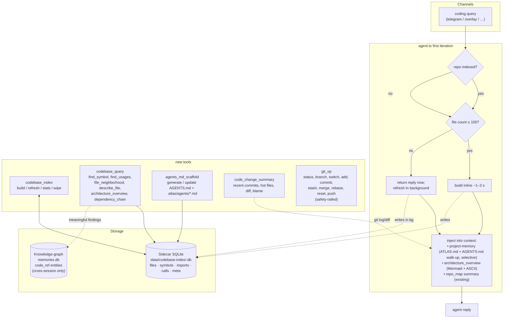

# Codebase Comprehension Layer — Design

> **Status:** Approved via brainstorming session · 2026-04-19
> **Scope:** Phase 4L — persistent codebase index, queryable mindmap, generated AGENTS.md split, any-codebase generalization, git operations on request
> **Target:** ATLAS source tree (`/Users/user/Desktop/ATLAS`) — local git repo, no GitHub remote

## Context

ATLAS already has the primitives to read code (`read`, `grep`, `glob`, `lsp`), a per-call symbol extractor (`repo_map`), and a walk-up project-memory loader for `ATLAS.md` / `.atlas/ATLAS.md`. What's missing is **persistent codebase comprehension**: every coding query rebuilds its understanding from scratch, and the agent has no durable mindmap to point new sessions at. This phase closes that gap.

Design constraints locked in during brainstorming:

1. **Index trigger:** both auto-build on first coding query *and* explicit tool for rebuild/stats/wipe.
2. **Doc format:** both `AGENTS.md` (portable, 60k+ repos, Linux-Foundation standard) *and* `ATLAS.md` (ATLAS-specific overrides). Walk-up reads both; ATLAS.md wins on conflicts.
3. **Graph depth:** adaptive — agent picks `symbols` | `imports` | `calls` from codebase signals; user can override.
4. **Mindmap format:** both Mermaid + ASCII tree emitted side-by-side in architecture overview output.
5. **Build timing:** adaptive — block inline for ≤100 files, async background otherwise.
6. **Storage:** hybrid (Approach C) — per-repo sidecar SQLite for all structural data, existing knowledge-graph for cross-session observations only.
7. **Scope:** must work with any local codebase, any language, any size. Git operations available on user request.

## Architecture

Hybrid storage. One sidecar SQLite per repo under `data/codebase-index/<repo_hash>.db`; the existing `memories.db` knowledge-graph receives only cross-session coding observations (not raw index rows). Four new tools plus an agent-first-iteration hook and an extended walk-up loader.



## Data model

### Sidecar SQLite schema — `data/codebase-index/<repo_hash>.db`

```sql
CREATE TABLE files (
  id          INTEGER PRIMARY KEY,
  path        TEXT UNIQUE NOT NULL,       -- relative to repo root
  sha256      TEXT NOT NULL,              -- content hash for Merkle invalidation
  lang        TEXT NOT NULL,              -- 'ts' | 'py' | 'rs' | 'go' | 'file-only' | ...
  loc         INTEGER NOT NULL,
  workspace   TEXT,                       -- monorepo workspace package name, nullable
  indexed_at  INTEGER NOT NULL            -- ms epoch
);

CREATE TABLE symbols (
  id          INTEGER PRIMARY KEY,
  file_id     INTEGER NOT NULL REFERENCES files(id) ON DELETE CASCADE,
  name        TEXT NOT NULL,
  kind        TEXT NOT NULL,              -- function | class | method | interface | type | enum | export | trait | struct | module
  line_start  INTEGER NOT NULL,
  line_end    INTEGER,
  signature   TEXT,                       -- best-effort param list + return type
  exported    INTEGER DEFAULT 0
);

CREATE TABLE imports (
  id            INTEGER PRIMARY KEY,
  from_file_id  INTEGER NOT NULL REFERENCES files(id) ON DELETE CASCADE,
  to_file_id    INTEGER REFERENCES files(id) ON DELETE SET NULL,
  specifier     TEXT NOT NULL,            -- './foo' | 'lodash' | '@/lib/x'
  line          INTEGER NOT NULL
);

CREATE TABLE calls (
  id              INTEGER PRIMARY KEY,
  from_symbol_id  INTEGER NOT NULL REFERENCES symbols(id) ON DELETE CASCADE,
  to_symbol_id    INTEGER REFERENCES symbols(id) ON DELETE SET NULL,
  callee_name     TEXT NOT NULL,          -- fallback when resolution fails
  line            INTEGER NOT NULL
);

CREATE TABLE parse_errors (
  file_id                INTEGER NOT NULL REFERENCES files(id) ON DELETE CASCADE,
  error                  TEXT NOT NULL,
  skip_until_hash_change TEXT NOT NULL,   -- quarantine: only re-attempt when file content changes
  recorded_at            INTEGER NOT NULL
);

CREATE TABLE index_meta (
  repo_root          TEXT PRIMARY KEY,    -- absolute path
  repo_hash          TEXT NOT NULL,
  depth              TEXT NOT NULL,       -- 'symbols' | 'imports' | 'calls'
  depth_auto         INTEGER NOT NULL,
  file_count         INTEGER NOT NULL,
  symbol_count       INTEGER NOT NULL,
  created_at         INTEGER NOT NULL,
  last_refreshed_at  INTEGER NOT NULL,
  tool_version       TEXT NOT NULL        -- bump forces full rebuild on schema change
);

CREATE INDEX idx_symbols_name ON symbols(name);
CREATE INDEX idx_symbols_file ON symbols(file_id);
CREATE INDEX idx_imports_from ON imports(from_file_id);
CREATE INDEX idx_imports_to   ON imports(to_file_id);
CREATE INDEX idx_calls_from   ON calls(from_symbol_id);
CREATE INDEX idx_calls_to     ON calls(to_symbol_id);
```

### Knowledge-graph bridge (reuses `memories.db`)

- Entity types: `code_ref::<file>::<symbol>` — created **only** when the agent records a cross-session observation.
- Relationship types: `code_discussed_in` (code_ref → session), `code_touched_together` (code_ref ↔ code_ref).
- Decay opt-out: `src/memory/self-evolving.ts` pruning rules extended to skip types prefixed `code_`.
- The sidecar **never** writes to `memories.db` at index time — cross-linking is explicit and rare.

### Per-repo keying

```
repo_root    = git rev-parse --show-toplevel || CWD
repo_hash    = sha256(repo_root).slice(0, 16)
sidecar_path = data/codebase-index/<repo_hash>.db
```

## Data flows

**Flow A — Auto-trigger on first coding query**
```
agent.ts first-iteration (coding task type)
  ↓
hasSidecar(cwd)?
  ├─ no  → build(cwd)          # cold start
  └─ yes → refresh(cwd)        # Merkle skips unchanged files
          ↓
pickTiming(fileCount)
  ├─ ≤100  → block inline (~1–3 s)
  └─ >100  → fire in background, return reply immediately
          ↓
injectIntoContext()
  ├─ <project_memory>  ← ATLAS.md + AGENTS.md walk-up (selective)
  ├─ <repo_map>        ← existing repo-map summary
  └─ <architecture>    ← NEW: Mermaid + ASCII from codebase_query
```

**Flow B — `codebase_index build` / `refresh`**
```
1. resolveRepoRoot(cwd)               # git rev-parse --show-toplevel || cwd
2. repoHash = sha256(root).slice(0,16)
3. openSidecar(data/codebase-index/<hash>.db)
4. pickDepth(root) or use --depth override
5. walkFiles(root)                    # gitignore-aware, size-tier mode
6. for each file:
     sha = sha256(readFile(path))
     if existsInDb(path) && db.sha == sha: continue     ← Merkle skip
     parse(path) → symbols + imports [+ calls if depth=calls]
     upsert files / symbols / imports / calls
7. resolveImports()                   # specifier → file_id, best-effort
8. update index_meta counts + timestamps
9. return { added, updated, unchanged, deleted, errors, elapsed_ms }
```

**Flow C — `codebase_query` operations (all sub-second, pure SQL)**
```
find_symbol(name, kind?)              → SELECT symbols WHERE name = ? [AND kind = ?]
find_usages(symbol)                   → JOIN calls UNION text grep fallback
file_neighborhood(path, depth=1)      → BFS on imports (in + out)
dependency_chain(from_file, to_file)  → SQL recursive CTE on imports
describe_file(path)                   → symbols + imports + importers + top callers
architecture_overview()               → dir grouping → Mermaid + ASCII
```

**Flow D — `agents_md_scaffold`**
```
1. detectStack()       # package.json, pyproject.toml, Cargo.toml, go.mod, Gemfile, etc.
2. detectCommands()    # scripts, Makefile targets, justfile
3. detectConventions() # tsconfig strict, biome, eslint, ruff, pyright configs
4. architecture_overview() from sidecar
5. Haiku one-liner overview (fallback: package.json description)
6. Emit:
     <repo-root>/AGENTS.md              ← short manifest (~100 lines)
     <repo-root>/.atlas/agents/
       architecture.md                   ← subsystem prose + Mermaid + ASCII
       conventions.md                    ← ESM rules, return shapes, fail-open
       workflows.md                      ← add-a-tool, modify-subsystem recipes
       quickref.md                       ← key-file table with line numbers
       gotchas.md                        ← landmines (auth files, amend, etc.)
       commands.md                       ← full scripts + env-var table
       recent.md                         ← git log summary + hot files
       notes.md                          ← self-updating <!-- @atlas:auto --> zone
7. If AGENTS.md or any sub-doc already exists:
     - Files with a leading <!-- @atlas:auto --> marker: fully regenerated
     - Files without the marker: human-owned — tool refuses overwrite
     - Root AGENTS.md: only the auto-zone (stats + sub-doc index) is regenerated;
       human-written sections (Overview intro paragraph, custom Commands, etc.) preserved
     - Machine-owned by default: recent.md, notes.md, and the Stats/Architecture
       blocks of architecture.md (each has the auto-marker at the top)
     - Human-owned by default: conventions.md, workflows.md, quickref.md,
       gotchas.md, commands.md (generated once; agent never overwrites)
8. Sub-doc granularity: agents_md_scaffold accepts { only: [...] } to regenerate
   a specific file (e.g. `only: ["recent.md"]` for a daily hot-files refresh)
   without touching anything else
```

**Flow E — `code_change_summary` (read-only, all local git)**
```
recent_commits(n)     → git log --oneline -n N --no-color
hot_files(days)       → git log --name-only --pretty=format: --since=<days>d | uniq -c | sort -rn
diff(base, target)    → git diff --stat <base>..<target>; unified diff trimmed
blame(file, line)     → git blame -L <line>,<line> <file>
```

Every command runs locally. Fails open if not a git repo.

**Flow F — `git_op` (write operations, user-asked only)**
```
tier = classifyOperation(op)
if tier == "confirm":
   return { preview: true, would_run, effect_summary, affected_files, diff_stat }
   ← agent surfaces preview; user approves; agent re-calls with confirmed: true
if tier == "destructive":
   require confirmed: true AND evidence_phrase matches ("reset hard" | "force push" etc.)
if tier == "blocked":
   return { error: "<reason> — blocked at tool layer" }
execute via spawn; audit-log; return { success, commit_sha?, hook_output? }
```

## Adaptive behaviour

**Depth picker — `pickDepth(rootDir)`**

| Signal | Effect |
|---|---|
| fileCount ≤ 500 | → `calls` (richest) |
| 500 – 5 000 | → `imports` |
| > 5 000 | → `symbols` |
| Typed-lang ratio < 30 % | Downgrade one tier (dynamic code → more regex false positives) |
| Language has no reliable call-extractor | Cap at `imports` |
| User passed `--depth` | Use verbatim, skip heuristics |

**Timing picker — `pickTiming(fileCount)`**

| Signal | Effect |
|---|---|
| fileCount ≤ 100 | **Block inline** — typical cold-build <1 s, warm-refresh <200 ms |
| fileCount > 100 | **Async** — return reply now, fire build/refresh in background |
| `ATLAS_INDEX_ASYNC=never` | Always block |
| `ATLAS_INDEX_ASYNC=force` | Always async |
| Refresh finds >30 % files dirty | Upgrade to async regardless of size |

## AGENTS.md split layout

```
<repo-root>/AGENTS.md                       # short index, ~1000 tokens, the manifest
<repo-root>/.atlas/agents/
  architecture.md         # subsystem prose + Mermaid diagrams + data-flow walkthroughs
  conventions.md          # ESM rules, return shapes, fail-open, copyright
  workflows.md            # how-to recipes (add-a-tool, modify-a-subsystem)
  quickref.md             # key-file table with line numbers
  gotchas.md              # landmines
  commands.md             # scripts + env-var table
  recent.md               # git log summary + hot files (regenerates each scaffold)
  notes.md                # the only self-updating doc
```

**Walk-up loader rules (extends `src/memory/project-memory.ts`):**

| Task type | Always loaded | Conditionally loaded |
|---|---|---|
| any | `AGENTS.md`, `gotchas.md`, `notes.md` | ATLAS.md overrides (if present) |
| coding | + `architecture.md`, `conventions.md`, `quickref.md` | `workflows.md` if multi-step |
| build / setup | | + `commands.md` |
| debug / refactor | | + `recent.md` |
| other | just `AGENTS.md` | nothing else |

Section markers (`<!-- @atlas:section:X -->`) inside sub-docs let the loader inject specific sub-sections further. Total injection budget capped at 16 KB (unchanged).

Authoring split: anything between `<!-- @atlas:auto -->` markers is machine-owned; everything else is human-owned after generation.

## Any-codebase generalization

**Language support tiers**

| Tier | Languages | Extraction |
|---|---|---|
| Full | TypeScript, JavaScript, Python, Rust, Go, Java, C#, Swift, Kotlin, Ruby, PHP | symbols + imports + best-effort calls |
| Structural | C, C++, Dart, Scala, Groovy, Elixir, Erlang, Haskell, OCaml, Clojure, Julia, R, Zig, Nim, Crystal | symbols + imports only |
| File-only | any other text file | file entity only |

Adding a new language = one entry in `PATTERNS` table + extension mapping. Framework is language-agnostic.

**Repo shapes**

| Shape | Handling |
|---|---|
| Git repo | `git rev-parse --show-toplevel` → root; sidecar keyed to hash(root) |
| Non-git folder | Fall back to CWD; `code_change_summary` returns `{ note: "not a git repo" }` |
| Monorepo (Turborepo / Nx / pnpm workspace / Lerna) | Each workspace tagged in `files.workspace`; architecture diagram shows workspace boundaries as subgraphs |
| Git submodules | Each submodule indexed separately (own sidecar by its own path hash) |
| Git worktrees | Each worktree's own sidecar; ATLAS agent worktrees explicitly excluded (`data/agent-worktrees/**`) |
| Sparse checkouts | Walker sees present files only; re-syncing sparse rules triggers full rebuild |
| Git-LFS pointer files | <200 bytes + `version https://git-lfs` prefix → skip parse, mark as LFS |

**Size tiers**

| Files | Strategy | Depth | Timing |
|---|---|---|---|
| ≤ 100 | full index | calls | block |
| 100 – 500 | full index | calls | async |
| 500 – 5 000 | full index | imports | async |
| 5 000 – 20 000 | full index | symbols | async |
| 20 000 – 100 000 | top-level + subtree on demand | symbols | async incremental |
| > 100 000 | lazy only — subtrees indexed when agent navigates in | symbols | lazy |

**Build-tool detection breadth**

Recognises (in order): `package.json`, `pyproject.toml`, `Pipfile`, `requirements*.txt`, `setup.cfg`, `Cargo.toml`, `go.mod`, `Gemfile`, `mix.exs`, `pubspec.yaml`, `composer.json`, `deno.json`, `bun.lockb`, `build.gradle(.kts)`, `pom.xml`, `CMakeLists.txt`, `Makefile`, `justfile`, `Taskfile.yml`, `rakefile`, `stack.yaml`, `cabal.project`, `deps.edn`, `project.clj`.

Convention configs: `tsconfig.json`, `.eslintrc*`, `biome.json`, `ruff.toml`, `pyrightconfig.json`, `.prettierrc*`, `rustfmt.toml`, `.golangci.yml`, `.editorconfig`.

**Parser robustness**

- Skip keyword matches in symbol extraction (`if`, `else`, `for`, `while`, `switch`, `case`, `try`, `catch`, `return`, `throw`, `new`, `delete`, `typeof`, `instanceof`, `constructor`)
- Line-by-line regex — avoids catastrophic backtracking
- Strip strings and comments before extracting imports
- Cap per-file work: >100 KB → file entity only, skip symbol parse
- Quarantine crashers via `parse_errors` table; retry only when content hash changes
- UTF-8 first, latin-1 fallback, skip with `encoding_error` on further failure

**Performance budgets**

| Repo size | Cold build | Warm refresh (0 dirty) | Warm refresh (10 % dirty) | `find_symbol` |
|---|---|---|---|---|
| 100 files | < 1 s | < 50 ms | < 300 ms | < 20 ms |
| 1 000 files | < 4 s | < 150 ms | < 1 s | < 30 ms |
| 10 000 files | < 25 s | < 1 s | < 5 s | < 50 ms |
| 100 000 files | lazy | | | < 100 ms |

Exceeding cliff = bug, not acceptable.

## Git operations on request (`git_op` tool)

Separate from read-side `code_change_summary`. Never auto-invoked; only called when the user explicitly asks for a git action.

### Operation table

| Operation | Args | Safety tier |
|---|---|---|
| `status` | — | Safe |
| `branch_list` | `verbose?`, `remote?` | Safe |
| `branch_create` | `name`, `from?` | Safe |
| `switch` | `branch`, `create?`, `stash_first?` | Safe when tree clean |
| `stash_push` / `stash_pop` / `stash_apply` / `stash_list` | — / `ref?` | Safe |
| `add` | `paths: string[]` | Safe — **refuses `-A` / `-u` / `.`** |
| `commit` | `message`, `paths?`, `amend?` | Safe unless `amend: true` (requires explicit user phrase) |
| `tag` | `name`, `message?`, `commit?` | Safe |
| `revert` | `commit` | Confirm |
| `cherry_pick` | `commit` | Confirm |
| `merge` | `branch`, `no_ff?` | Confirm unless fast-forward |
| `rebase` | `onto`, `interactive?` | Confirm; `interactive: true` blocked |
| `reset` | `mode`, `to` | Confirm always; `hard` requires explicit phrase |
| `clean` | `paths?`, `force?`, `dirs?` | Confirm always; `-x` requires explicit phrase |
| `push` | `remote?`, `branch?`, `force?`, `force_with_lease?`, `set_upstream?` | Confirm always; `force` to main/master/production blocked |

### Hard safety rails (enforced at tool layer)

1. Never `--no-verify`, `--no-gpg-sign`
2. Never `git config` modifications
3. Never force-push to `main` / `master` / `production` / `release/*`
4. No interactive commands (`rebase -i`, `commit -e`) — no TTY
5. `add` only accepts explicit paths — no `-A`, `-u`, `.`
6. Pre-commit hooks always run; on failure → new commit (never `--amend`)
7. Dirty-tree `switch` refused unless `stash_first: true`
8. `push` validates remote against configured upstreams
9. In ATLAS Phase 4G agent worktrees: `push` is blocked entirely

### Confirm semantics

```
1. Agent calls git_op with operation + preview: true (default for Confirm tier)
2. Tool returns { preview: true, would_run, effect, affected_files, diff_stat }
3. Agent surfaces preview to user via existing <tool_log> channel
4. User approves → agent calls git_op with confirmed: true [+ evidence_phrase for destructive]
5. Tool verifies HEAD hasn't moved → executes → audit-logs → returns { success, commit_sha? }
```

Destructive ops (`reset --hard`, `clean -fd`, `push --force`) additionally require an `evidence_phrase` argument whose value is a substring of the user's own message in the current turn. The tool re-reads the latest user message (surfaced via the existing agent-loop context) and rejects if the phrase isn't present verbatim. This prevents the agent from confirming destructive ops on its own.

### Prompt addition to `prompts/coding.md`

> **Git operations.** Read-side (`code_change_summary`) is free to call for context. Write-side (`git_op`) is only called when the user explicitly asks. Never auto-commit, never auto-push, never amend unless the user said "amend". For destructive ops, surface the preview and wait for explicit approval before confirming. Force-push to main/master/production is blocked at the tool layer — don't try to work around it.

## Error handling (all fail-open)

| Failure | Recovery |
|---|---|
| Build fails mid-walk | Rollback partial inserts via SQLite tx; log failed files; keep succeeded |
| Sidecar DB corrupted | `PRAGMA integrity_check` on open → delete + rebuild |
| Schema version mismatch | `index_meta.tool_version` diff → drop sidecar, full rebuild |
| Disk full | Abort, log, fall back to `repo_map` + `grep`; don't mark repo as indexed |
| Git unavailable | `resolveRepoRoot` → CWD; `code_change_summary` returns `{ note: "not a git repo" }` |
| Permission denied | Skip file, record `{ path, error }` in result, continue |
| Symlink loop | Depth cap 20 + visited-inode set in walker |
| Concurrent build | File lock at `<sidecar>.lock`; second builder waits with timeout; falls back to existing index |
| File changes mid-build | Snapshot `mtime` + `sha256` at parse time; dirty files picked up next refresh |
| Mermaid syntax error | Fall back to ASCII tree only; note in output |
| AGENTS.md already human-edited | Refuse overwrite; offer `{merge, update-auto-zone-only, skip}` |
| Walk-up file too large | Existing 8 KB/file, 16 KB total cap truncation |
| Haiku one-liner fails | Fall back to deterministic one-liner from `package.json` `description` |
| `codebase_index wipe` mid-query | Foreign-key `ON DELETE CASCADE`; queries complete against snapshot |

## Kill-switches (env vars, all default off)

```
ATLAS_NO_CODEBASE_INDEX=true          # disable auto-build + auto-inject entirely
ATLAS_NO_ARCHITECTURE_INJECTION=true  # build index but don't inject overview
ATLAS_INDEX_ASYNC=force|never          # override timing heuristic
ATLAS_INDEX_DEPTH=symbols|imports|calls   # override depth heuristic
```

## Testing strategy

**Unit smoke (scratch scripts, `npx tsx /tmp/smoke-*.mts`):**
- `parse-ts.mts` — 5 hand-crafted TS fixtures (pure TS, mixed JS, dynamic imports, re-exports, classes with methods) → verify symbol counts + kinds
- `merkle-refresh.mts` — build → modify one file → refresh → verify only dirty file re-parsed
- `depth-picker.mts` — synthetic counts (50 / 500 / 5000 / 50000) + lang ratios → verify returned tier
- `timing-picker.mts` — same shape, verify block vs async decision
- `resolve-repo-root.mts` — git repo / subdir / non-git → verify root + hash
- `agents-md-write.mts` — virgin repo / existing AGENTS.md / existing with auto-zone marker → verify behaviour matrix
- `git-op-safety.mts` — verify `-A`/`-u`/`.` refused by `add`, force-push to `main` blocked, `--no-verify` stripped

**Integration smoke (against ATLAS itself):**
- `codebase_index build .` → ~285 TS files, 1000s of symbols, <5 s
- `codebase_query find_symbol("runAgent")` → hit in `src/agent.ts`
- `codebase_query find_usages("runAgent")` → hits across `src/telegram.ts`, `src/discord.ts`, `src/whatsapp.ts`, `src/agents/sub-agent.ts`
- `codebase_query architecture_overview()` → valid Mermaid + non-empty ASCII
- `agents_md_scaffold` → emits `/tmp/atlas-test-agents/AGENTS.md` + 8 sub-docs, all non-empty
- `code_change_summary recent_commits(5)` → last 5 local commits

**Regression matrix (must pass unchanged):**
Phase 1–4 smoke matrix: chat · memory · browser · research · long-task · WhatsApp (5 flows) · voice · overlay · proactive · boot. Binary pass/fail gate.

## Observability

- Every tool logs one line on entry + exit with duration + counts: `[codebase_index] build ./src: 287 files, 3421 symbols, 147 imports, 2.1s`
- Writes audit-logged via existing `auditLog()`
- `codebase_query stats` exposes: file count, symbol count, depth, last refresh, sidecar size
- Build errors collected into result: `{ added, updated, unchanged, deleted, errors: [...] }`

## Rollback plan

1. Flip `ATLAS_NO_CODEBASE_INDEX=true` → kills auto-trigger + injection at the call site
2. Sidecar DBs stay on disk (safe to ignore)
3. Walk-up loader still reads ATLAS.md (pre-phase behaviour)
4. Explicit tool calls still work — user/agent can query / scaffold manually

No migration needed. Pure additive.

## Critical files to create / modify

**New files**
- `src/memory/codebase-index.ts` — build/refresh/stats/wipe core
- `src/memory/code-parse/` — per-language regex extractors (ts.ts, py.ts, rs.ts, go.ts, …) + shared types
- `src/tools/coding/codebase-index.ts` — tool handler
- `src/tools/coding/codebase-query.ts` — tool handler
- `src/tools/coding/agents-md-scaffold.ts` — scaffolder with AGENTS.md + `.atlas/agents/*.md` emission
- `src/tools/coding/code-change-summary.ts` — git read helpers
- `src/tools/coding/git-op.ts` — safety-railed git mutation tool
- `src/memory/codebase-merkle.ts` — file hashing + dirty detection helpers

**Existing files to modify**
- `src/memory/project-memory.ts` — extend `FILE_CANDIDATES` to include `AGENTS.md`, `.atlas/agents/*.md`; task-type-aware selective loading via section markers
- `src/memory/knowledge-graph.ts` — no schema change; `code_*` type exclusion moves to `self-evolving.ts`
- `src/memory/self-evolving.ts` — decay / prune rules skip `code_*` types
- `src/agent.ts` — first-iteration coding path: auto-trigger + architecture overview injection
- `src/agents/sub-agent.ts` — add new tools to `coder` role
- `src/tool-router.ts` — add tools to `coding` category; KEYWORD_BOOSTS for codebase-comprehension phrasings + git operations
- `src/tools/index.ts` — register new tools
- `prompts/coding.md` — Codebase Comprehension workflow section + Git operations rules
- `skills/ui_ux_designer.md` (and/or) — unchanged here; a new `codebase_analyst` skill MAY be added later

**Existing code reused**
- `src/tools/repo-map.ts` — regex patterns + language detection stay canonical source for per-language extraction
- `src/memory/sqlite.ts` — reuse `Database` abstraction for sidecar
- `src/memory/knowledge-graph.ts` — reused for cross-session observations
- `src/security/allowlist.ts` — `isPathAllowed` / `isProtectedPath` enforced on every sidecar / AGENTS.md write
- `src/security/audit-log.ts` — `auditLog()` on every mutation
- Existing `parseGitignore` in `src/tools/repo-map.ts` — reused by walker

## Verification

**After each sub-phase:**
- `npm run build && npm run typecheck` — clean
- `npx biome check --write --unsafe <changed-files>` — clean
- Unit smoke scripts — all pass
- `codebase_index stats` on ATLAS itself — returns plausible counts

**Feature smokes:**
- Ask Telegram: "where is `runAgent` called from?" → sees results from `codebase_query find_usages` without the agent running raw grep
- Ask: "give me an architecture overview of this repo" → Mermaid + ASCII in reply
- Run `agents_md_scaffold` in a fresh folder with a Next.js starter → emits AGENTS.md + 8 sub-docs; re-run honours existing human edits
- Ask: "commit these staged changes with message 'feat: …'" → `git_op commit` runs, pre-commit hook fires, new commit SHA returned
- Ask: "force push to main" → blocked with clear error
- Ask: "reset --hard HEAD~1" → confirm preview, require explicit phrase, then execute only after it arrives

**Regression:**
Full Phase 1–4 smoke matrix still passes. Zero delta in non-coding flows.

## Shipping order (within this phase)

1. `codebase-index.ts` + per-language extractors + sidecar schema
2. `codebase-index` tool (build / refresh / stats / wipe)
3. `codebase-query` tool (all 6 operations including Mermaid output)
4. `code-change-summary` tool (read-only git)
5. `agents-md-scaffold` tool (root AGENTS.md + `.atlas/agents/*.md` split)
6. Walk-up loader extension (selective section injection)
7. `agent.ts` first-iteration auto-trigger + architecture injection
8. `git_op` tool (write-side, safety rails)
9. `prompts/coding.md` codebase-comprehension + git-op sections
10. Router sync — category tools + KEYWORD_BOOSTS
11. Regression test matrix

Stop after any step — each is self-contained.
